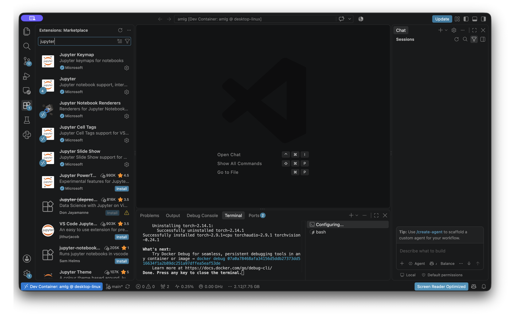
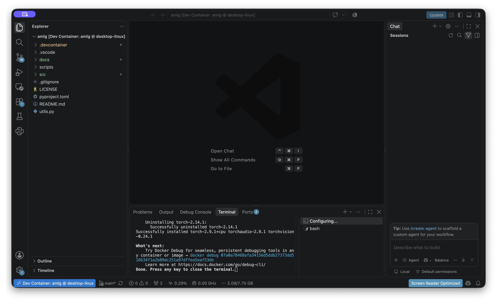
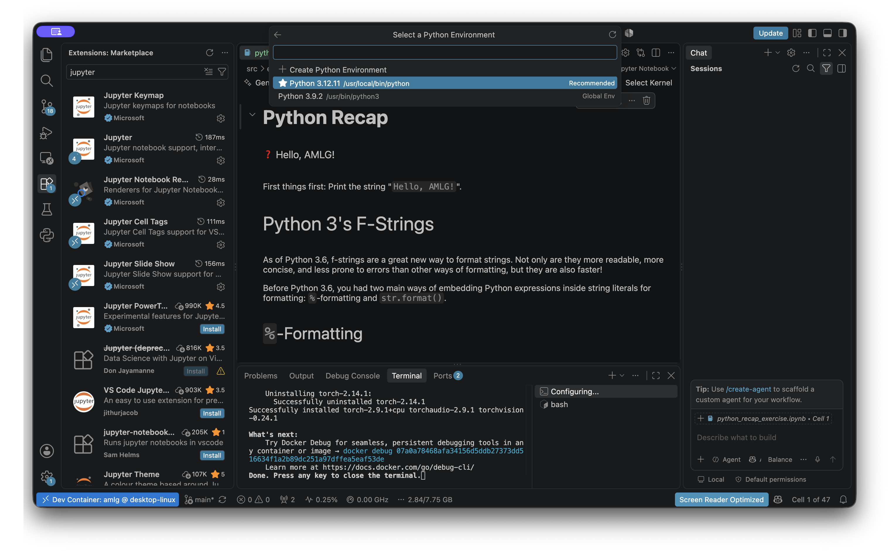
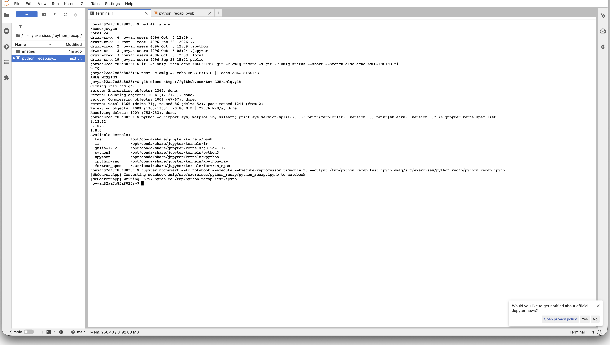
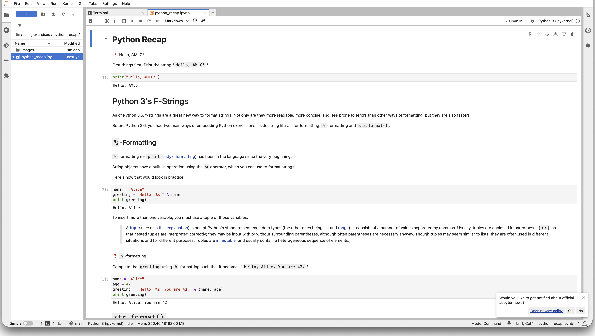

# AMLG student setup guide

Choose **one** of the following environments:

- **Option A — VS Code + Dev Container (recommended):** reproducible and closest to the course development environment.
- **Option B — GWDG Jupyter Cloud:** runs in a browser and does not require local Docker.

In both cases, clone the official course repository, not a tutor's fork:

```text
https://github.com/tnt-LUH/amlg.git
```

## Option A — VS Code + Dev Container

### 1. Install the prerequisites

Install:

- [Git](https://git-scm.com/downloads)
- [Visual Studio Code](https://code.visualstudio.com/download)
- [Docker Desktop](https://www.docker.com/products/docker-desktop/)
- the [Dev Containers](https://marketplace.visualstudio.com/items?itemName=ms-vscode-remote.remote-containers) and [Jupyter](https://marketplace.visualstudio.com/items?itemName=ms-toolsai.jupyter) VS Code extensions

Open Docker Desktop and wait until its engine reports that it is running. On Windows, Docker Desktop may ask you to enable WSL 2 and restart the computer.

In VS Code, open **Extensions** (`Ctrl+Shift+X` on Windows/Linux or `Cmd+Shift+X` on macOS), search for each extension, and check that it is installed.



**Expected result:** Git, VS Code, Docker Desktop, Dev Containers, and Jupyter are available.

### 2. Clone and open the course repository

Open a terminal and run:

```bash
git clone https://github.com/tnt-LUH/amlg.git
cd amlg
code .
```

If the `code` command is unavailable, open VS Code, select **File > Open Folder…**, and choose the downloaded `amlg` folder.

**Expected result:** the Explorer in VS Code shows `README.md`, `.devcontainer`, and `src`.

### 3. Start the Dev Container

Press `F1` (or `Cmd+Shift+P` on macOS), type **Dev Containers: Reopen in Container**, and select that command. Keep Docker Desktop running while VS Code builds the environment. The first build downloads an image and installs packages, so it can take several minutes.



**Expected result:** the lower-left status area says **Dev Container: amlg** and the setup terminal finishes without an error.

If VS Code asks whether it may install the recommended extensions inside the container, allow it.

### 4. Open Python Recap and select its kernel

In the Explorer, open:

```text
src/exercises/python_recap/python_recap_exercise.ipynb
```

Exercise notebooks end in `_exercise.ipynb`. The notebook without that suffix contains the completed solution and should only be used for help.

Click the kernel name in the top-right corner of the notebook. Choose the recommended Python interpreter in the Dev Container (currently `/usr/local/bin/python`, Python 3.12).



**Expected result:** the kernel area shows Python 3 and notebook cells have a Run button.

### 5. Run and save your work

In the first task cell, enter:

```python
print("Hello, AMLG!")
```

Select the cell and press `Shift+Enter`, or click its Run button. The output should be:

```text
Hello, AMLG!
```

Save your work regularly. To keep the original exercise unchanged, use **File > Save As…** and choose a personal name such as `python_recap_yourname.ipynb`.

### VS Code troubleshooting

- **Docker is not running:** start Docker Desktop, wait for it to become ready, then reopen the folder in the container.
- **Reopen in Container is missing:** install or enable the Dev Containers extension and reload VS Code.
- **No kernel is offered:** verify that the bottom-left status says `Dev Container: amlg`; then choose `/usr/local/bin/python` from **Select Kernel > Python Environments**.
- **The container build fails:** run **Dev Containers: Rebuild Container**. If it still fails, copy the first error message and ask a tutor.
- **A notebook contains old output:** use **Clear All Outputs** before rerunning it.

## Option B — GWDG Jupyter Cloud

This option was tested in the GWDG environment. It uses its own Python installation; the repository's `.devcontainer` is not used.

### 1. Log in and start JupyterLab

Open [GWDG Jupyter Cloud](https://jupyter-cloud.gwdg.de), sign in with your institution account, and start JupyterLab. If the service asks for a server profile, use the course recommendation or the default profile unless your tutor says otherwise.

**Expected result:** JupyterLab opens with a file browser on the left and a Launcher in the main area.

### 2. Clone the official repository

From the Launcher, open **Terminal** and run:

```bash
cd ~
git clone https://github.com/tnt-LUH/amlg.git
cd amlg
```

If `~/amlg` already exists, do not clone over it. Instead run:

```bash
cd ~/amlg
git status
git pull --ff-only
```



**Expected result:** the left file browser contains an `amlg` folder.

### 3. Open Python Recap and select a kernel

In the file browser, open:

```text
amlg/src/exercises/python_recap/python_recap_exercise.ipynb
```

Click the kernel name at the top right and select **Python 3 (ipykernel)**. During the October 2026 test, GWDG provided Python 3.13 with the required `matplotlib` and `scikit-learn` packages.



**Expected result:** the kernel indicator is ready and running the first cell prints `Hello, AMLG!`.

If the exercise notebook has not yet been released for the current week, only the solution notebook may be present. Ask the tutor before working in the solution file.

### 4. Save your work

Use **File > Save Notebook As…** to create a personal copy before editing. JupyterLab normally autosaves, but also press `Ctrl+S` or `Cmd+S` regularly. Keep the notebook in your GWDG home directory or download a backup with **File > Save and Export Notebook As > Notebook**.

### GWDG troubleshooting

- **The repository folder already exists:** use the update commands above; do not clone into the existing folder.
- **The notebook says “No Kernel”:** select **Python 3 (ipykernel)** from the kernel menu.
- **A package is missing:** do not install system-wide packages. Show the error to a tutor; a user-level or course environment fix may be needed.
- **The server stops:** return to the Jupyter Cloud page and restart it. Files in your home directory should remain available.
- **Changes from the course repository are missing:** close notebooks with unsaved changes, open a Terminal, and run `git pull --ff-only` inside `~/amlg`.

## What was tested

- The Dev Container built successfully on Apple Silicon with Python 3.12, Jupyter, `matplotlib`, `scikit-learn`, and CPU PyTorch.
- Every code cell in the Python Recap solution ran successfully inside the Dev Container.
- GWDG JupyterLab cloned the official repository, started the Python 3 kernel, and executed the Python Recap notebook successfully.
